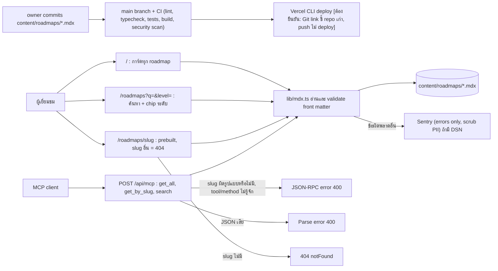

# 01 — Business process (As-Is / To-Be)

devtools-roadmaps-web คือเว็บอ้างอิงแบบ static ที่แสดง career learning roadmap 3 เส้นทาง (Product Manager, Web Developer, Data Scientist) ให้ผู้เยี่ยมชม portfolio อ่านและค้นหา เนื้อหาเป็นไฟล์ MDX ใน repo เท่านั้น ไม่มีบัญชีผู้ใช้หรือที่เก็บข้อมูล และมี endpoint `/api/mcp` ให้ agent อ่านเนื้อหาชุดเดียวกัน

Last reviewed: 2026-11-28 · commit `d62a22b`

## As-Is (จากโค้ดวันนี้)

Sources: `content/roadmaps/*.mdx`, `lib/mdx.ts`, `app/page.tsx`, `app/roadmaps/page.tsx`, `app/roadmaps/[slug]/page.tsx`, `app/api/mcp/route.ts`, `lib/sentry.ts`, `next.config.ts`, `PRODUCT.md`, `README.md`

หมายเหตุจากโค้ด: ค่า progress ใน front matter เป็นข้อมูลตัวอย่างที่ใช้เรียงลำดับ ไม่แสดงในหน้า แต่ยังอยู่ในคำตอบ MCP; `/more-projects` redirect ถาวรไป bookchaowalit.com

## To-Be (`PRODUCT.md` §Live URL and deploy state)

Sources: `PRODUCT.md` (owner action D9: reconnect Vercel Git to this repository)

## Gap

| ID | As-Is → To-Be | Status | Owner | Evidence |
|---|---|---|---|---|
| G1 | deploy ด้วย Vercel CLI, Git link ชี้ repo เก่า, commit L2 (MCP จริง, Sentry) อาจยังไม่ขึ้น production → เชื่อม Vercel Git กับ repo นี้ | decide | owner | `PRODUCT.md` §Live URL and deploy state (owner action D9) [ต้องยืนยัน: สถานะปัจจุบัน] |

## Open questions

- Vercel Git link ของโปรเจกต์ `bookchaowalit-roadmaps-frontend` ชี้ repo นี้แล้วหรือยัง (PRODUCT.md เขียนไว้ ณ 2026-10-23)
